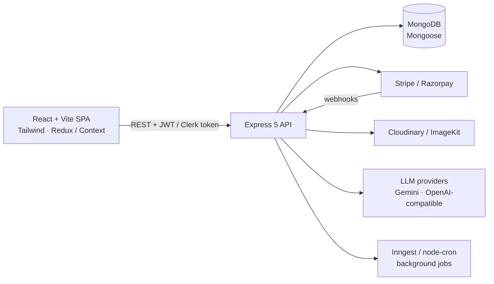

<div align="center">

# Hi 👋, I'm Ayush Verma

### Full Stack / MERN Developer · Building production-style web apps with TypeScript and AI integrations

📍 Ajmer, Rajasthan, India &nbsp;•&nbsp; 🟢 Open to Full Stack / MERN Stack roles

<a href="https://www.linkedin.com/in/ayush-verma-2b8223329/"></a>
<a href="mailto:ayve012@gmail.com"></a>
<a href="https://my-new-portfolio-site.vercel.app"></a>

</div>

---

## 👨‍💻 About Me

I'm a motivated, detail-oriented **MERN Stack developer** who learns by shipping. Since joining GitHub in mid-2024 I have gone from recreating UI clones in React to building **complete, deployed, multi-role products**: authentication, payments, webhooks, background jobs, admin dashboards and AI pipelines.

What I enjoy most is turning real-world business logic (bookings, payroll, inventory, scheduling) into clean, reliable and user-friendly applications.

- 🚀 **Focus right now:** production-ready MERN apps, TypeScript, and AI-powered features (LLM code generation, content generation, resume tooling)
- 🧱 **How I build:** monorepo layout (`client/` + `server/`), REST APIs, role-based access control, deployed on Vercel / Render
- 🌱 **Always learning:** Angular, Vue and Next.js alongside React, plus deeper backend patterns such as background jobs and webhooks
- 🤝 **Looking for:** a Full Stack / MERN Stack developer role, and collaborations on projects that stretch my skills

---

## 📊 At a Glance

| | |
|---|---|
| **Public repositories** | 45 |
| **Deployed live apps** | 30+ with live demo links |
| **Primary languages** | JavaScript, TypeScript |
| **Frameworks used** | React, Next.js, Angular, Vue, React Native (Expo) |
| **Typical stack** | MongoDB · Express 5 · React 19 · Node.js · Tailwind CSS 4 |
| **GitHub member since** | July 2024 |

---

## 🛠️ Tech Stack

### Languages


### Frontend


**Also:** React Router, Context API, Vuex, shadcn/ui (Radix), Sandpack, Axios

### Backend & Database


**Also:** REST API design, bcrypt, Multer, Nodemailer, node-cron, Helmet, express-rate-limit, Zod, MongoDB transactions

### Auth, Payments & Third-Party Services


**Also:** Svix webhook verification, Inngest (background jobs & cron), ImageKit, Brevo SMTP, TMDB API, TheMealDB API

### AI & LLM Integration


**Also:** OpenRouter, Leonardo AI (image generation), structured LLM output with Zod schemas

### Mobile


### Deployment & Tools


---

## 🤖 Featured: AI-Powered Applications

| Project | What it does | Highlights |
|---|---|---|
| **[SiteSpark](https://github.com/Ayush-verma25/SiteSpark-AI-Website-Builder-App)** · [Live](https://site-spark-ai-website-builder-app-t.vercel.app/login) | Describe a website in plain English and an AI agent plans it, writes the React code and previews it live. Users can then refine it by chatting, edit code by hand, publish in one click, or export a ZIP. | Two-phase generation pipeline (plan the file structure, then write each file) · bounded concurrency · validation and auto-fix of generated code · live Sandpack preview · Vercel AI SDK + OpenRouter with Zod-typed output |
| **[PostPilot](https://github.com/Ayush-verma25/PostPilot-Social-Media-Automation-Platform-App)** · [Live](https://postpilot-social-media-automation.onrender.com) | Write, AI-generate, schedule and publish posts to X/Twitter, LinkedIn, Facebook and Instagram from one dashboard. | Full **TypeScript** (strict) on client and server · Gemini for text, Leonardo AI for images · retry with backoff and model fallback · `node-cron` scheduler running every minute · Helmet + rate limiting |
| **[ResumeNova](https://github.com/Ayush-verma25/ResumeNova-AI-Resume-Builder-APP)** · [Live](https://resume-nova-ai-resume-builder-app.vercel.app) | AI resume builder to create, polish, import, share and print professional resumes. | OpenAI-compatible LLM backend · PDF-to-text import · ImageKit for image handling · JWT auth with Redux Toolkit |

---

## 🧩 Featured: Full-Stack Business Platforms (MERN)

<details open>
<summary><b>Click to collapse / expand the project list</b></summary>

<br/>

| Project | Domain | Key features & integrations |
|---|---|---|
| **[WorkPilot](https://github.com/Ayush-verma25/WorkPilot_Employment_Management_App_MERN)** · [Live](https://work-pilot-employment-management-ap-six.vercel.app) | HR / Employee management | Separate **Admin and Employee portals** · attendance, leave and payroll · MongoDB transactions · **Inngest** durable background jobs and cron · email via Nodemailer · automated tests with Node's test runner + `mongodb-memory-server` |
| **[BiteMo](https://github.com/Ayush-verma25/BiteMo-App)** · [Live](https://bite-mo-app-client.vercel.app/) | Restaurant discovery & table booking | **TypeScript**, React 19, Tailwind 4 · three roles (guest, owner, admin) · admin approval workflow · live seat availability per time slot · shareable URL-based filters |
| **[QuickShow](https://github.com/Ayush-verma25/QuickShow-Movie-App-MERN)** · [Live](https://quickshow-movie-app-mern-client.vercel.app/) | Movie ticket booking | Clerk auth · seat selection · **Stripe Checkout + webhook** · TMDB API · Inngest background jobs and booking emails · admin dashboard |
| **[QuickStay](https://github.com/Ayush-verma25/QuickStay-Hotel-Booking-App)** · [Live](https://quick-stay-hotel-booking-app-io73.vercel.app/) | Hotel booking | Live room availability · Clerk + Svix webhooks · Stripe payments · Cloudinary image uploads · Brevo email confirmations · hotel-owner dashboard for rooms, bookings and revenue |
| **[GreenCart](https://github.com/Ayush-verma25/Green-Cart-MERN)** · [Live](https://green-cart-mern-client.vercel.app/) | Grocery e-commerce | Cash on Delivery or Stripe · DB-synced cart · seller dashboard · multi-image upload to Cloudinary · JWT in httpOnly cookies |
| **[SkillSpring LMS](https://github.com/Ayush-verma25/LMS-Website-App-MERN)** · [Live](https://lms-website-app-mern-jhzn.vercel.app/) | Learning management system | Educator and student roles · Clerk + webhooks · Stripe payments · Quill rich-text editor · YouTube lecture player · course progress tracking |
| **[Doctor Appointment System](https://github.com/Ayush-verma25/Doctor-Appointment-Booking-System-MERN)** · [Live](https://doctor-appointment-booking-system-mern-vct1.onrender.com) | Healthcare booking | Three apps (patient, admin, doctor) with separate JWT middleware · Razorpay online payments · Cloudinary uploads |
| **[JobPortal](https://github.com/Ayush-verma25/JobPortal-App-MERN)** · [Live](https://jobportal-app-mern-client.vercel.app/) | Job marketplace | Student and recruiter roles · apply / accept / reject flow with duplicate-application blocking · resume upload · Redux Toolkit + redux-persist · shadcn/ui · bcrypt with 12 rounds |
| **[Zomo](https://github.com/Ayush-verma25/Zomo-Food-Delivery-App-MERN)** · [Live](https://zomo-food-delivery-app-mern-frontend.onrender.com) | Food delivery | Zomato-inspired MERN application |
| **[E-Commerce Shopping Site](https://github.com/Ayush-verma25/E-Commerce-Shopping-Site-using-MERN)** · [Live](https://e-commerce-shopping-site-using-mern-8nu3.onrender.com) | Clothing marketplace | React (Vite) storefront with a separate admin panel · buyers and sellers · deployed on Render |

> ℹ️ Some backends run on free tiers (Render), so the first request can take 30–60 seconds to wake up.

</details>

---

## ⚛️ Next.js, Angular, Vue & More

<details>
<summary><b>Beyond MERN: other frameworks I've worked with</b></summary>

<br/>

| Project | Stack | Notes |
|---|---|---|
| **[LMS Course Platform](https://github.com/Ayush-verma25/Lms-Course-Platform-NextJs)** · [Live](https://lms-course-platform-next-js.vercel.app) | Next.js 15, TypeScript, Clerk, Sanity CMS + Studio, Stripe, Redux Toolkit | Tutors publish courses via Sanity Studio; students buy with Stripe |
| **[Next.js Blog App](https://github.com/Ayush-verma25/Nextjs-Blog-App)** · [Live](https://nextjs-blog-app-xi-tawny.vercel.app) | Next.js 14, TypeScript, Tailwind, Redux Toolkit, Framer Motion | Blog platform with an admin dashboard |
| **[YourCartShop](https://github.com/Ayush-verma25/YourCartShop-App-Angular)** · [Live](https://your-cart-shop-app-angular.vercel.app) | Angular 16, TypeScript, Bootstrap 5, RxJS | Category browsing and filtering, product details, cart with quantities, demo COD checkout |
| **[Search Meals](https://github.com/Ayush-verma25/Search-Meals-with-VueJS)** · [Live](https://search-meals-with-vue-js.vercel.app) | Vue 3 (Composition API), Vuex, Vue Router, Tailwind, Axios | Recipe search by name, letter and ingredient using TheMealDB API |
| **[Crypto Tracker](https://github.com/Ayush-verma25/Full-Stack-Crypto-Tracker-App)** · [Live](https://full-stack-crypto-tracker-app.vercel.app) | Full-stack JavaScript | Top 10 cryptocurrencies with prices refreshed every 3 minutes |
| **[Job Scheduler](https://github.com/Ayush-verma25/job-scheduler-using-NodeJS)** | Node.js | Backend system to run tasks at a specific time or at repeating intervals |
| **[Hulu 2.0](https://github.com/Ayush-verma25/Hulu-2.0-NextJs-TailwindCss)** · **[Airbnb Clone](https://github.com/Ayush-verma25/Airbnb-clone-using-NEXTJS)** | Next.js, Tailwind CSS | UI-focused clones of streaming and travel platforms |
| **React Native / Expo apps** ([Delivero](https://github.com/Ayush-verma25/Delivero-Food-Delivery-App-Using-Expo-React-Native), [Todo with Firebase](https://github.com/Ayush-verma25/React-native-Todo-List-using-Firebase-NoSQL), [Todo with MongoDB](https://github.com/Ayush-verma25/React-native-Todolist-using-MongoDB)) | React Native, Expo, Firebase, MongoDB | Early mobile experiments |

</details>

<details>
<summary><b>Early work: React & JavaScript fundamentals</b></summary>

<br/>

My first repositories (2024) were hands-on practice in component design, state and API consumption:
[Netflix Clone](https://github.com/Ayush-verma25/Netflix-Clone-2-ReactJs) ·
[Slack Clone](https://github.com/Ayush-verma25/Slack-Clone-2.0-ReactJs) ·
[Snapchat Clone](https://github.com/Ayush-verma25/SnapChat-Clone-ReactJS) ·
[WhatsApp Clone](https://github.com/Ayush-verma25/Whatsapp-2-clone) ·
[Spotify Clone](https://github.com/Ayush-verma25/Sportify-Clone-using--React-js) ·
[Weather App](https://github.com/Ayush-verma25/Weather-Forcast-App-Using-ReactJS) ·
[QR Code Generator](https://github.com/Ayush-verma25/QR-Code-Generator-using-Javascript) ·
[To-Do List](https://github.com/Ayush-verma25/To-DO-List-using-Javascript) ·
[Music Player UI](https://github.com/Ayush-verma25/music-player-ui-react) ·
[Travel Site](https://github.com/Ayush-verma25/Travel-Site-Using-React) ·
[Portfolio](https://github.com/Ayush-verma25/My-Portpholio-App-React)

</details>

---

## 🔍 What My Projects Show

Across the repositories above, a few engineering patterns repeat:

| Area | What I've implemented |
|---|---|
| 🔐 **Auth & access control** | JWT (httpOnly cookies and Bearer tokens), Clerk, bcrypt hashing, role-based routes for guest / user / owner / educator / recruiter / admin |
| 💳 **Payments** | Stripe Checkout with webhook handling, Razorpay orders, Cash-on-Delivery flows |
| 🔄 **Async & background work** | Inngest durable functions, `node-cron` schedulers, event-driven email notifications, polling for long-running AI jobs |
| 🤖 **AI features** | Multi-step LLM pipelines, structured (schema-validated) output, retries and model fallback, text and image generation |
| 🗄️ **Data modelling** | Mongoose schemas with relations, availability and booking logic, transactions for payroll and leave |
| ☁️ **Integrations** | Cloudinary, ImageKit, Svix, SMTP email, TMDB, TheMealDB, social-media publishing APIs |
| 🛡️ **Security basics** | Input validation, Helmet, rate limiting, hashed passwords, secrets kept in environment variables, protected admin routes |
| 🚢 **Delivery** | Monorepo `client/` + `server/`, Vercel and Render deployments, thorough READMEs with architecture diagrams and API references |

### Typical architecture I use



---

## 📈 Growth Path

```text
2024   React fundamentals → UI clones, JavaScript mini-projects
2025   Next.js + Tailwind → React Native / Expo → Node.js scheduler → first full-stack MERN apps
2026   Production-style MERN products → Stripe/Clerk/Razorpay → TypeScript → AI-powered apps
```

**Currently exploring:** deeper TypeScript on the backend, background-job architectures, and agent-style AI workflows.

---

## 📊 GitHub Stats

<div align="center">


</div>

---

## 📫 Let's Connect

I'm actively looking for a **Full Stack Developer / MERN Stack Developer** role, and I'm happy to collaborate on projects that help me grow.

- 💼 LinkedIn: [ayush-verma-2b8223329](https://www.linkedin.com/in/ayush-verma-2b8223329/)
- 📧 Email: [ayve012@gmail.com](mailto:ayve012@gmail.com)
- 🌐 Portfolio: [my-new-portfolio-site.vercel.app](https://my-new-portfolio-site.vercel.app)

<!--
OPTIONAL: add these sections if you want them (I could not verify them from your GitHub account):

## 🎓 Education
- Degree / College / Year

## 🏆 Certifications & Achievements
- ...
-->

<div align="center">

⭐ If you like any of my projects, a star on the repo means a lot. Thanks for visiting! 🙌

</div>
